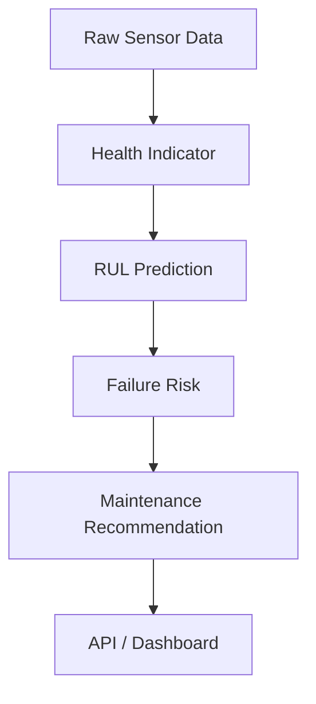
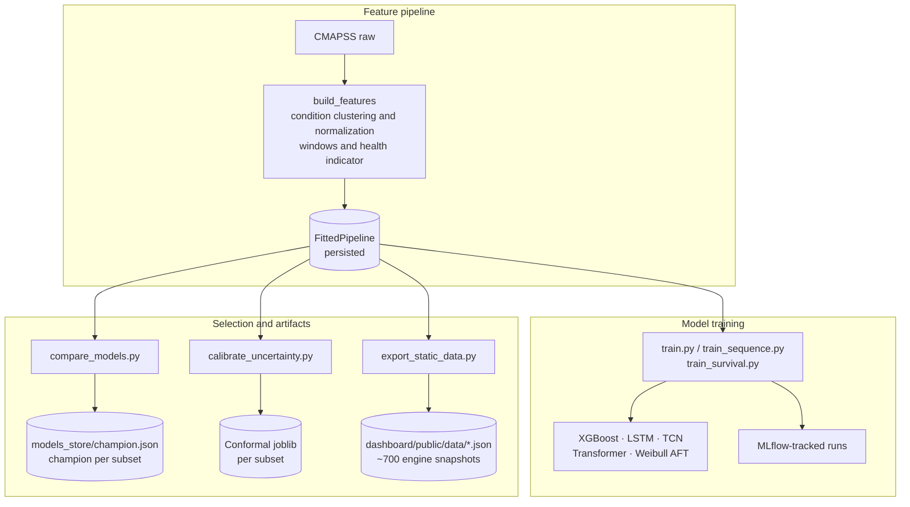
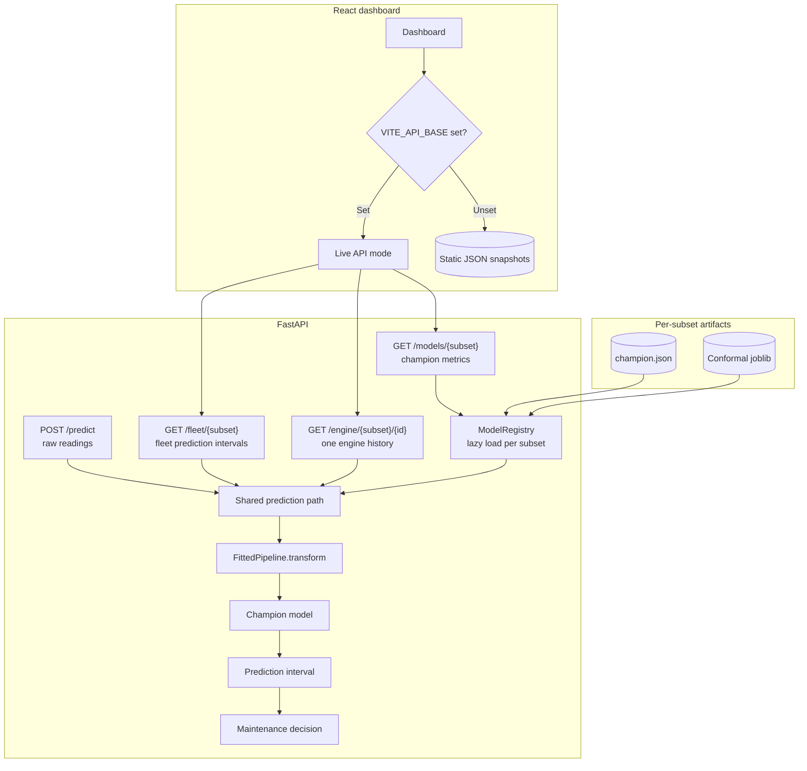

# AeroRUL — Turbofan Engine Remaining Useful Life Prediction

A predictive-maintenance system for jet engines, built end-to-end: raw sensor telemetry in,
a maintenance recommendation out.



> "Engine #37 has approximately 24 cycles remaining before failure — ground for inspection."

That's the shape of every prediction this system makes. Not a metric on a leaderboard — a
sentence a maintenance planner can act on.

## Why this exists

Unplanned failures are the expensive kind. A component that's inspected too early wastes
service life and technician time; one that fails in service costs far more — downtime,
emergency logistics, and in aerospace, a safety incident. The gap between those two outcomes
is exactly what Remaining Useful Life (RUL) prediction is for: turn a stream of noisy
sensor readings into a number precise enough, and *trusted* enough, to schedule maintenance
against.

That's also what makes this a meaningfully different exercise than a typical "download a
Kaggle dataset, fit a model, report accuracy" project. A single RMSE number doesn't tell a
maintenance planner anything — they need a point estimate *and* a sense of how much to trust
it, ideally with a business-legible risk tier attached, served somewhere a monitoring
dashboard can actually consume it. So the goal here wasn't "predict RUL" — it was: build the
whole system a real MLE would be asked to ship for this problem, end to end, and be honest
about where it's strong and where it isn't.

Concretely, that meant:

- **Feature engineering** that respects the physics of the problem — six different operating
  conditions need condition-aware normalization, or a model spends its capacity
  distinguishing altitude from wear instead of learning degradation.
- **Model comparison, not a single model.** Five genuinely different approaches (gradient
  boosting, three neural sequence architectures, and a survival-analysis model) evaluated
  consistently, with the actual winner picked per-subset rather than assumed in advance.
- **Uncertainty, not just a point estimate.** A calibrated prediction interval, so "24 cycles"
  comes with an honest sense of how wrong it might be.
- **A caught bug, not a hidden one.** Partway through, the evaluation code turned out to be
  scoring against the wrong target (see [Results](#results) below) — silently making one
  subset's baseline look 45% better than it actually was. Finding that, understanding *why*
  it happened, and fixing it everywhere it appeared is in some ways the most representative
  part of this project: production ML work is as much about catching exactly this kind of
  quiet correctness bug as it is about model architecture.
- **A served, usable system** — a FastAPI service backing a real React dashboard, not a
  notebook that stops at `model.predict()`.

The result is five Jupyter notebooks that walk through the entire pipeline in detail (see
[Notebooks](#notebooks)), a production-shaped codebase behind them, and a dashboard a
non-technical stakeholder could actually open and understand.

## Results

Every model below is evaluated identically: RMSE, MAE, and the NASA PHM08 asymmetric scoring
function (which penalizes *late* predictions — telling a planner an engine has more life
than it does — far more heavily than early ones), scored against the **true** RUL from
`RUL_*.txt`, not the RUL-capped training label.

| Subset | Champion | RMSE | MAE | NASA score | Runner-up |
|--------|----------|-----:|----:|-----------:|-----------|
| FD001  | transformer | 16.0 | 12.2 | 439 | tcn (558) |
| FD002  | tcn         | 28.3 | 19.4 | 10,486 | xgboost (11,118) |
| FD003  | transformer | 16.0 | 11.7 | 549 | xgboost (1,225) |
| FD004  | transformer | 26.6 | 19.5 | 5,647 | lstm (5,869) |

*(Regenerate with `uv run python scripts/compare_models.py --subset all` — writes
`models_store/champion.json`, which the API reads to decide which model to serve.)*

**What the numbers actually say, not just what they are:**

- **FD002 and FD004 are genuinely harder** — six operating conditions and (on FD003/FD004)
  two fault modes, not just an artifact of preprocessing. Every model's error roughly
  doubles versus FD001/FD003, and on FD002 XGBoost is essentially tied with the deep models
  — the sequence architectures' edge is concentrated on the single-condition subsets, where
  there's a cleaner temporal pattern to actually learn.
- **Survival analysis (Weibull AFT) loses on NASA score everywhere**, despite a solid
  ~0.80-0.82 concordance index (it correctly ranks which of two engines fails first ~80% of
  the time). A handful of engines get a badly-overestimated median remaining life, and the
  NASA score's asymmetric penalty punishes those outliers heavily. It's kept in the
  comparison deliberately, not as a strawman — it's the only model here that natively
  produces a full probability distribution over failure time instead of one number, which
  matters for questions a point estimate can't answer.
- **Uncertainty intervals under-cover on FD002/FD004** — about 76-80% empirical coverage
  against a 90% target, versus 89-96% on FD001/FD003. Calibration is filtered to exclude
  RUL-cap-contaminated rows (see below), but residual-distribution shift between the
  calibration split and the true test set is larger on the harder, multi-condition subsets.
  Treat interval widths there as optimistic, not wrong — and that gap is reported here
  rather than smoothed over.

### The bug: evaluating against the wrong target

Training every model targets RUL **capped** at 125 cycles — a standard trick, since an
engine ~300 cycles from failure shows negligible wear and asking a model to distinguish "300
left" from "280 left" just adds noise to the loss with no learnable signal behind it.

The bug: the *evaluation* code was scoring predictions against that same capped label instead
of the true, uncapped RUL from `RUL_*.txt`. For engines with a lot of life left, that hides
the error almost entirely — 57 of FD002's 259 test engines have true RUL above the 125-cycle
cap, and evaluating against the cap made XGBoost's FD002 RMSE look like **15.2** instead of
its real **27.7**. The fix touched four places (`train.py`, `train_sequence.py`,
`compare_models.py`, and the conformal-calibration diagnostic in
`calibrate_uncertainty.py`), plus a follow-up: the *calibration set* for conformal intervals
had the identical contamination (early-life training rows also have true RUL past the cap),
so it needed the same filter. All of it is walked through with real before/after numbers in
notebook 04 and the git history — nothing here is quietly patched over.

## Notebooks

Five notebooks, one per pipeline stage, each executed end-to-end with real output (not
placeholder code) — open them directly on GitHub or run them locally.

| Notebook | Covers |
|---|---|
| [`01_data_preprocessing.ipynb`](notebooks/01_data_preprocessing.ipynb) | Raw data structure, RUL labeling (capped vs. uncapped, with plots), operating-condition clustering, per-condition normalization, rolling-window features, the health indicator |
| [`02_eda_analysis.ipynb`](notebooks/02_eda_analysis.ipynb) | Engine lifetime distributions, why the RUL cap matters (visualized), sensor degradation trends, correlation structure, cycles-before-failure alignment |
| [`03_modeling.ipynb`](notebooks/03_modeling.ipynb) | XGBoost trained live with feature importances; LSTM/TCN/Transformer architecture comparison and evaluation; Weibull AFT survival curves; full cross-subset model comparison with champion selection |
| [`04_uncertainty_survival.ipynb`](notebooks/04_uncertainty_survival.ipynb) | Split conformal prediction from first principles, the coverage/width tradeoff, per-engine interval visualization, survival-curve interpretation, and how both feed the maintenance-decision layer |
| [`05_api_deployment.ipynb`](notebooks/05_api_deployment.ipynb) | The FastAPI service exercised in-process end-to-end — health, fleet, engine drill-down, live prediction, and the model-comparison endpoint — plus the Docker deployment path |

## Architecture

```
src/aerorul/
  data/          raw-file loading, schema/constants
  features/      RUL labeling, per-condition normalization, rolling-window features
  models/        XGBoost, LSTM, TCN, Transformer, Weibull AFT survival, decision layer
  evaluation/    RMSE + NASA asymmetric scoring function
  uncertainty/   split conformal prediction intervals
api/             FastAPI service (predict / fleet / engine / models / health)
dashboard/       React fleet-health dashboard -- runs backend-free (public/data/ JSON
                 snapshots) or against the live API, same codebase either way
scripts/         data download, training (per model type), comparison, evaluation,
                 static-data export for the backend-free dashboard build
notebooks/       the five notebooks above
data/            raw + processed CMAPSS data (gitignored, see data/README.md)
models_store/    trained model artifacts + champion.json (gitignored except champion.json)
```

**Request flow, prediction to dashboard:** the API's `ModelRegistry` loads each subset's
champion model (from `champion.json`) and its calibrated conformal interval lazily on first
request, then dispatches every prediction — whether from `/predict` (raw sensor readings),
`/fleet` (the whole test-set fleet), or `/engine` (one engine's full history) — through the
same feature pipeline the model was trained with (`FittedPipeline.transform`), so training-
and inference-time features are guaranteed to match.

## System Design

The Architecture section above maps the code layout. This section covers requirements, the training-to-serving lifecycle, the API contract, and trade-offs.

### Requirements

**Functional**
- Turn raw engine sensor telemetry into RUL, an uncertainty interval, a risk tier, and a maintenance recommendation.
- Serve fleet-level views, per-engine history, and model metadata to a dashboard; support live prediction on arbitrary readings.

**Non-functional**
- **Asymmetric safety**: late predictions are penalized more heavily (NASA PHM08 score), so model selection uses that score, not only RMSE.
- **Train/serve parity**: inference must apply exactly the fitted feature pipeline used in training.
- **Calibrated trust**: intervals carry a finite-sample coverage guarantee (split conformal).
- **Cheap hosting**: the dashboard must work on a static host with no backend.

### Lifecycle

Training and artifact lifecycle:



Serving and dashboard paths:



### Decision Layer

`models/decision.py` maps predicted cycles remaining to `critical`, `high`, `medium`, or `low` tiers. The thresholds are set relative to the training RUL cap (125), and each tier carries a fixed recommendation (for example, "ground engine for inspection"). Keeping this mapping in code, outside the model, lets operations tune thresholds without retraining.

### Scale and Reliability

- Inference is CPU-only and stateless after model load. Horizontal scaling is a matter of container replicas; cold start is dominated by lazy model loading.
- Model artefacts and raw data are baked into the API image, so a deployment needs no external volumes.
- The static dashboard has no runtime dependencies. Per-engine JSON files keep the fleet view from loading every engine's full history at once.

### Trade-offs

| Decision | Benefit | Cost |
| --- | --- | --- |
| Champion per subset, chosen by NASA score | Best model for each operating regime | Several models to maintain and serve |
| Global split-conformal interval | Simple, guaranteed marginal coverage | Under-covers harder subsets (FD002/FD004) |
| Static snapshot mode | Free hosting, zero backend | Snapshots go stale until regenerated after retraining |
| Artefacts baked into the image | Self-contained deploys | Image rebuild needed for every model update |

### What to Revisit as It Grows

- Move artefacts to an MLflow model registry (or object storage) and load by version, so models can be promoted without rebuilding images.
- Add conditional conformal intervals per operating condition or risk tier.
- Add data-drift monitoring on incoming sensor distributions and a scheduled retraining trigger.
- Support streaming ingestion (Kafka or MQTT) for live fleets instead of the fixed test set.

## Skills demonstrated

| Area | Where |
|---|---|
| Time-series feature engineering | `src/aerorul/features/` — condition clustering, rolling windows, health indicator |
| Classical ML | XGBoost baseline, feature importance analysis |
| Deep learning | LSTM, dilated-causal-conv TCN, and Transformer-encoder regressors in PyTorch, built from scratch |
| Survival analysis | Weibull AFT via `lifelines`, landmark time-to-failure formulation, concordance index |
| Uncertainty quantification | Split conformal prediction with a finite-sample coverage guarantee |
| Rigorous evaluation | NASA PHM08 asymmetric scoring, and finding + fixing a real evaluate-on-the-wrong-target bug |
| MLOps | MLflow experiment tracking, model-comparison-driven champion selection, artifact versioning |
| API design | FastAPI service with a clean, typed contract (Pydantic schemas) |
| Frontend | React + TypeScript dashboard consuming that API, with risk-tiered views and uncertainty bands |
| Deployment | Docker + docker-compose for the full stack |

## Getting started

### Backend (data, training, API)

```bash
scripts/download_data.sh              # fetch raw CMAPSS data into data/raw/
uv sync --extra api --extra dev --extra dl --extra survival --extra notebooks

uv run python scripts/build_features.py --subset all      # cache engineered features
uv run python scripts/train.py --subset all               # XGBoost baseline
uv run python scripts/train_sequence.py --subset all --model all   # LSTM, TCN, Transformer
uv run python scripts/train_survival.py --subset all       # Weibull AFT survival model
uv run python scripts/calibrate_uncertainty.py --subset all        # conformal intervals
uv run python scripts/compare_models.py --subset all       # picks each subset's champion

uv run uvicorn api.main:app --reload --port 8000
```

Try it: `curl http://localhost:8000/fleet/FD001` or open http://localhost:8000/docs for the
interactive OpenAPI UI.

### Notebooks

```bash
uv run jupyter lab notebooks/
```

### Dashboard

```bash
cd dashboard
npm install
npm run dev          # http://localhost:5173, defaults to the API at http://localhost:8000
```

### Everything via Docker

The API image bakes `models_store/` and `data/raw/` in at build time, so it's fully
self-contained -- no volumes needed at deploy time, just train once beforehand:

```bash
scripts/download_data.sh
uv run python scripts/train.py --subset all
uv run python scripts/train_sequence.py --subset all --model all
uv run python scripts/train_survival.py --subset all
uv run python scripts/calibrate_uncertainty.py --subset all
uv run python scripts/compare_models.py --subset all

docker compose up --build
```
API on http://localhost:8000, dashboard on http://localhost:5173.

## Deployment

The dashboard runs two ways from the same codebase, chosen automatically at build time by
whether `VITE_API_BASE` is set:

**Backend-free (static)** -- `/fleet`, `/engine`, and `/models` are all just predictions
over the fixed CMAPSS test set, computed once, so there's nothing genuinely "live" about
them. `scripts/export_static_data.py` freezes that data to JSON under
`dashboard/public/data/` (already committed, ~19MB across ~700 files -- one per engine, so
loading the fleet view doesn't pull in every engine's full sensor history at once); a
production build (`npm run build`) with no `VITE_API_BASE` configured reads those files
directly. Deploy `dashboard/` to Vercel (or Netlify, or any static host) with zero backend
involved:

```bash
uv run python scripts/export_static_data.py --subset all   # regenerate after retraining
```
Then point Vercel at the `dashboard/` directory (framework preset: Vite) and deploy. The
only thing this mode can't do is `POST /predict` (live inference on arbitrary sensor
readings) -- the dashboard UI doesn't call that endpoint, so nothing is lost in practice.

**Live API** -- set `VITE_API_BASE` to a deployed FastAPI instance (see `api/Dockerfile`;
Render or Fly.io are natural fits since both run the Dockerfile directly) and the dashboard
build hits it for real. Both configurations ship in this repo; which one a given deployment
uses is a single build-time environment variable, not a code fork.

## What's next

- **Sequence models on FD002/FD004** currently use the same architectures and window length
  as FD001/FD003 — a condition-aware architecture (e.g. feeding the operating-condition
  cluster as an explicit input, or per-condition sub-models) is the most promising lever for
  closing the gap on the harder subsets.
- **Conditional conformal prediction** to fix the FD002/FD004 coverage shortfall — calibrate
  interval width per operating-condition or per-risk-tier bucket rather than one global `q`.
- **A learned health indicator** (currently a hand-designed sign-aligned average) — an
  autoencoder reconstruction-error signal is the natural next step and would plug into the
  same downstream pipeline unchanged.

## Dataset

NASA CMAPSS (Commercial Modular Aero-Propulsion System Simulation) — simulated turbofan
degradation runs across 4 subsets varying in operating conditions and fault modes. Each
engine is described by 3 operational settings and 21 sensor channels, run from healthy to
failure (train) or truncated before failure with a true RUL label (test). See
[data/README.md](data/README.md) for details.

Citation: Saxena, A., Goebel, K., Simon, D., & Eklund, N. (2008). *Damage propagation
modeling for aircraft engine run-to-failure simulation.* International Conference on
Prognostics and Health Management.
